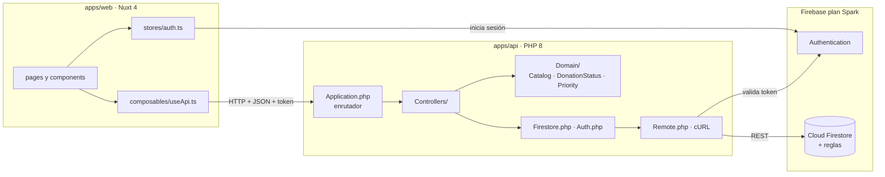

# Arquitectura

ReFood Connect es un monorepo con dos aplicaciones. El navegador nunca escribe directo en Firestore. Todo pasa por la API en PHP, que habla con Firebase usando el token del usuario. Así las reglas de Firestore protegen los datos aunque alguien llame a Firebase sin pasar por la API.

## Diagrama de componentes

## Capas

| Capa | Carpeta | Hace | No hace |
| --- | --- | --- | --- |
| Interfaz | `apps/web/app/` | Pantallas, formularios, sesión y llamadas a la API | Reglas de negocio |
| Enrutador | `apps/api/src/Application.php` | Elige el controlador de cada ruta y convierte errores a JSON | Lógica de negocio |
| Casos de uso | `apps/api/src/Controllers/` | Valida la entrada, revisa el rol y arma las escrituras | Cálculos de dominio |
| Dominio | `apps/api/src/Domain/` | Estados permitidos, catálogos, kilos y prioridad | Llamadas a red |
| Persistencia | `Firestore.php`, `Auth.php`, `Remote.php` | Habla con Firebase por REST | Decisiones de negocio |

## Qué pasa cuando un receptor reserva

1. En el detalle de la donación presiona Reservar.
2. `useApi.ts` pide el token a Firebase y manda `POST /api/v1/reservations`.
3. `ReservationController` valida el token, revisa que el rol sea `RECEIVER` y que la donación siga publicada y vigente.
4. Arma un solo commit de Firestore con dos escrituras. Crea `reservations/{id de la donación}` con la condición de que no exista, y pasa la donación a Reservada.
5. Si otra organización reservó un instante antes, Firestore rechaza el commit completo y la API responde 409.

## Decisiones

| Decisión | Por qué |
| --- | --- |
| El id de la reserva es el id de la donación | Firestore no deja crear dos documentos con el mismo id, así nunca hay dos reservas |
| Escrituras con `documents:commit` | Reservar, liberar, cancelar y entregar cambian varios documentos y se guardan todos o ninguno |
| Catálogo en un solo lugar | Categorías, unidades y zonas viven en `Catalog.php` y el front las pide a `GET /catalog` |
| Evidencia como enlace | Cloud Storage dejó de estar en el plan Spark en febrero de 2026 |
| La API usa el token del usuario | No hace falta una cuenta de servicio y las reglas se aplican siempre |
