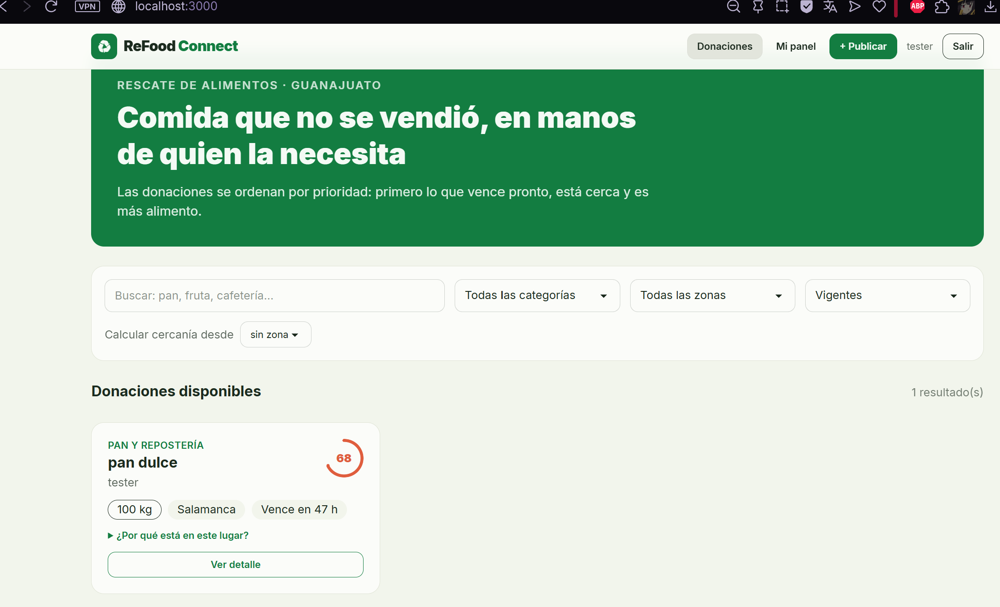
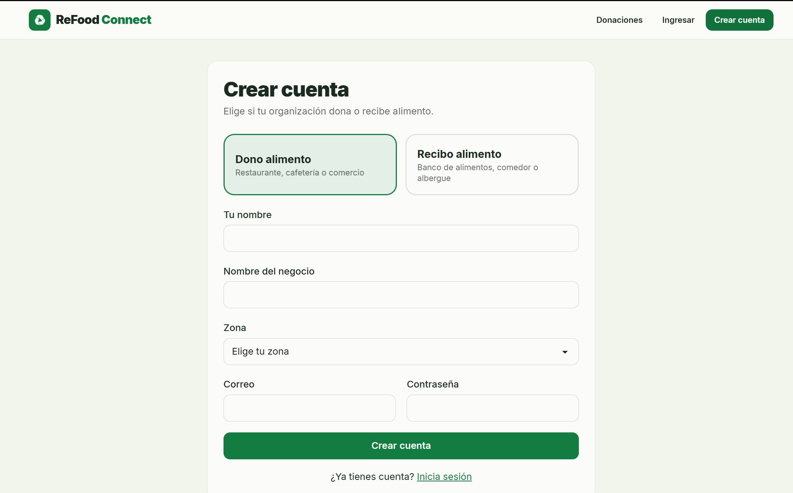
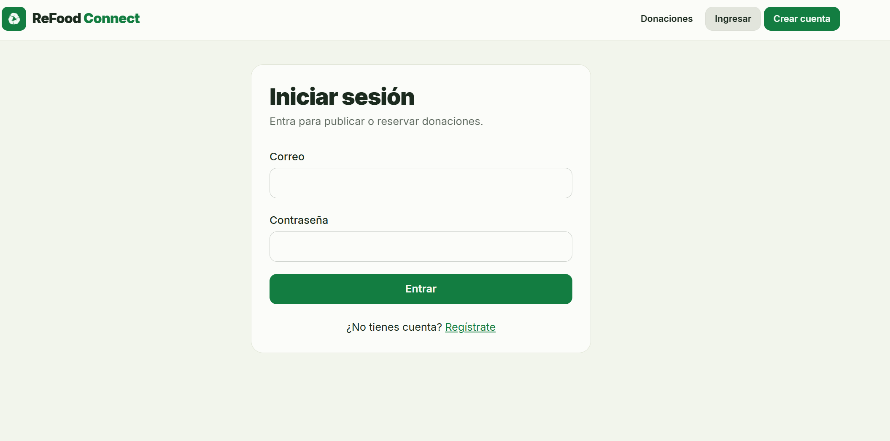
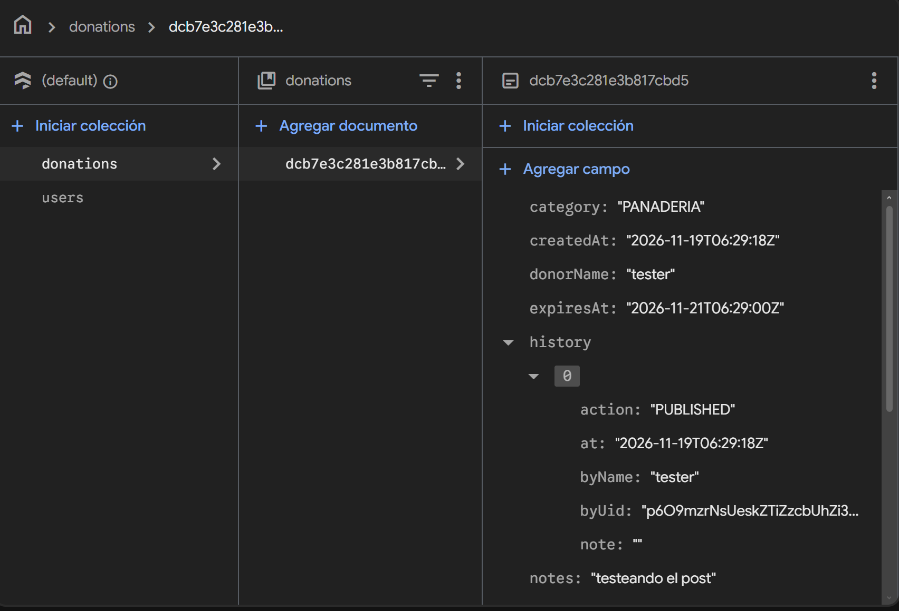

# Revisión 1 · jueves 19 de noviembre de 2026

**Tag:** `revision-1-2026-11-19`
**Responsable de este archivo:** Raúl Santiago Leyva Carral

## Qué pidió el maestro para esta revisión

- README con problema, objetivo, alcance MVP, roles, integrantes y tecnología.
- Al menos 5 historias de usuario, diagrama de componentes y modelo inicial de Firestore.
- Diseño navegable de 4 pantallas.
- Proyecto ejecutable con autenticación, primer rol y una operación de alta y consulta persistente.

## Checklist

- [x] README completo ([README.md](../../README.md))
- [x] 9 historias de usuario ([historias-de-usuario.md](../historias-de-usuario.md))
- [x] Diagrama de componentes ([arquitectura.md](../arquitectura.md))
- [x] Modelo de Firestore y reglas ([modelo-firestore.md](../modelo-firestore.md))
- [x] Pantallas navegables: inicio, registro, login, publicar, detalle y panel del donador
- [x] Registro de donador guarda `users/{uid}` en Firestore
- [x] Publicar una donación la guarda en `donations` y aparece en el listado
- [x] `npm run test:api` aprobado

## Responsables y pull requests

| Integrante | Qué hizo | Pull request | Commits |
| --- | --- | --- | --- |
| Sebastián Adair López Gutiérrez | Paso 0, API de perfiles y donaciones, tag | #PENDIENTE | enlace |
| Raúl Santiago Leyva Carral | Dominio, Firestore, reglas, pruebas de catálogo, este archivo | #PENDIENTE | enlace |
| Hugo Alejandro Villaseñor Calderón | Contrato del front, registro, login, publicar y panel del donador | #PENDIENTE | enlace |
| Gustavo Hernández Licea | Listado con filtros, tarjetas, prioridad, detalle | #PENDIENTE | enlace |

Para obtener el enlace de un PR abre la pestaña Pull requests en GitHub, filtra por Closed y copia la dirección.

## Pruebas

```text

> refood-connect@1.0.0 test:api
> php apps/api/tests/run.php


CatalogTest
  [OK]    Un kilo vale un kilo y un litro también
  [OK]    Las piezas y porciones se convierten a kilos
  [OK]    La distancia de una zona a sí misma es 0 km
  [OK]    De Guanajuato capital a Silao hay entre 15 y 25 km
  [OK]    Una zona que no existe no tiene distancia

Pruebas aprobadas: 5  |  Fallidas: 0
```

## Capturas

| Pantalla | Archivo |
| --- | --- |
| Inicio con donaciones |  |
| Registro |  |
| Publicar donación |  |
| Detalle con prioridad |  |
| Inicio de sesión |  |
| Documento en la consola de Firestore |  |

## Pendientes para la siguiente revisión

- Reserva única de donaciones, editar y cancelar.
- Pantalla de mis reservas.