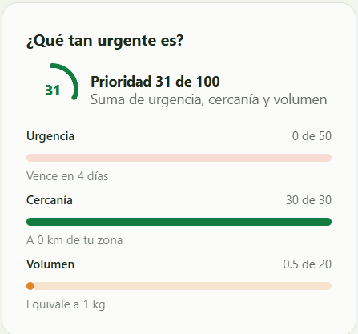
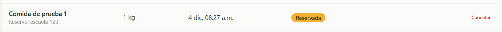
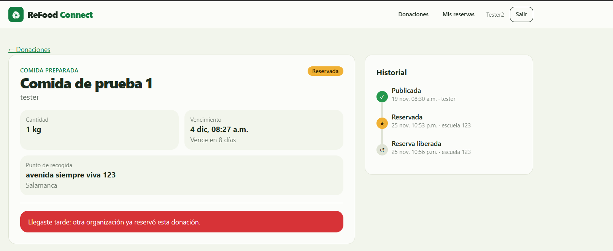
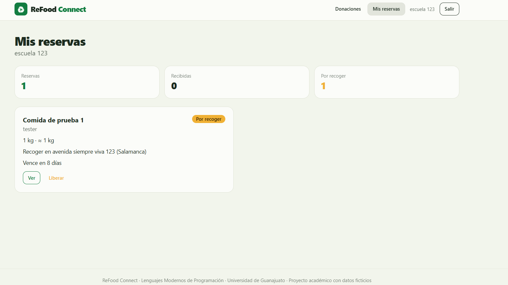
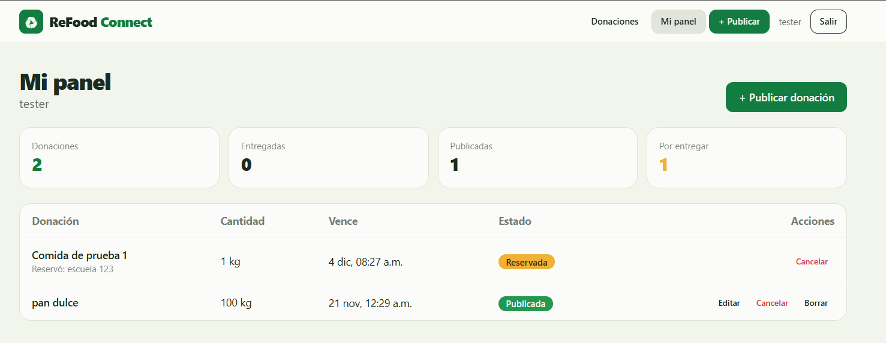

# Revisión 2 · jueves 26 de noviembre de 2026

**Tag:** `revision-2-2026-11-26`
**Responsable de este archivo:** Gustavo Hernández Licea

## Qué pidió el maestro para esta revisión

- CRUD principal y permisos efectivos para dos roles.
- Flujo central completo con cambios de estado y validación en la API.
- Función innovadora en prototipo ejecutable con datos de prueba y resultados observables.
- Documentación de endpoints y al menos 5 pruebas automatizadas aprobadas.
- Este archivo, PRs integrados y el tag.

## Checklist

- [x] Editar, cancelar y borrar donaciones
- [x] Reserva única. Segunda reserva rechazada con 409
- [x] Liberar reserva devuelve la donación a Publicada
- [x] Un receptor no puede publicar y un donador no puede reservar (403)
- [x] Prioridad visible con su explicación en el listado y en el detalle
- [x] [api.md](../api.md) y [algoritmo-prioridad.md](../algoritmo-prioridad.md)
- [x] `npm run test:api` con 23 pruebas aprobadas

## Responsables y pull requests

| Integrante | Qué hizo | Pull request | Commits |
| --- | --- | --- | --- |
| Sebastián Adair López Gutiérrez | Reserva única, editar, cancelar y borrar | #11 | https://github.com/alxandercal/Proyecto-Lenguajes_modernos/pull/11 |
| Raúl Santiago Leyva Carral | Pruebas unitarias, documento del algoritmo y de la API | #12 | https://github.com/alxandercal/Proyecto-Lenguajes_modernos/pull/12 |
| Hugo Alejandro Villaseñor Calderón | Editar donación y acciones del panel del donador | #15 | https://github.com/alxandercal/Proyecto-Lenguajes_modernos/pull/15 |
| Gustavo Hernández Licea | Reservar y liberar en el detalle, Mis reservas, este archivo | #16 | https://github.com/alxandercal/Proyecto-Lenguajes_modernos/pull/16 |

Para obtener el enlace de un PR abre la pestaña Pull requests en GitHub, filtra por Closed y copia la dirección.

## Pruebas

```text
PS C:\Users\zpato\Documents\Lenguajes modernos\Proyecto-Final\refood-connect> npm run test:api


> refood-connect@1.0.0 test:api
> php apps/api/tests/run.php


CatalogTest
  [OK]    Un kilo vale un kilo y un litro también
  [OK]    Las piezas y porciones se convierten a kilos
  [OK]    La distancia de una zona a sí misma es 0 km
  [OK]    De Guanajuato capital a Silao hay entre 15 y 25 km
  [OK]    Una zona que no existe no tiene distancia

DonationStatusTest
  [OK]    Un receptor puede reservar una donación publicada
  [OK]    Un donador no puede reservar
  [OK]    Una donación reservada no admite una segunda reserva
  [OK]    Solo el donador confirma la entrega de una reservada
  [OK]    Entregada y Cancelada son estados finales

PriorityTest
  [OK]    Ejemplo a mano: 5 kg que vencen en 24 h en la misma zona dan 69
  [OK]    Lo que vence en 3 h va antes que lo que vence en 3 días
  [OK]    Con el mismo vencimiento, gana la más cercana
  [OK]    El puntaje queda entre 0 y 100 y trae 3 factores
  [OK]    Sin zona del receptor la cercanía vale la mitad
  [OK]    Los mismos datos dan siempre el mismo resultado

ValidatorTest
  [OK]    El texto se limpia de espacios de sobra
  [OK]    Un título muy corto se rechaza con 422
  [OK]    La cantidad 0 o negativa se rechaza
  [OK]    Una fecha que ya pasó se rechaza
  [OK]    Una fecha futura se guarda en UTC
  [OK]    Un identificador con ../ se rechaza con 400
  [OK]    El enlace de evidencia debe ser https

Pruebas aprobadas: 23  |  Fallidas: 0
```

## Capturas


| Pantalla | Archivo |
| --- | --- |
| Listado visto por un receptor con prioridad |  |
| Donación reservada |  |
| Segunda reserva rechazada |  |
| Mis reservas |  |
| Panel del donador con acciones |  |


